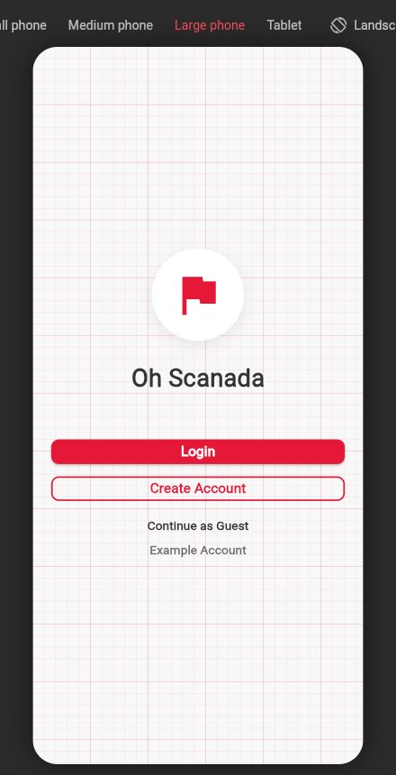
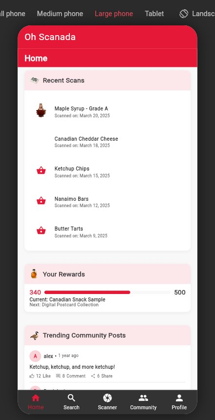

# Oh Scanada

A Flutter app that scans product barcodes and tells you whether a product is Canadian, with product details, an AI health and sustainability summary, community posts and rewards.

<p>
  
  
</p>

## Features

- **Barcode scanning:** reads UPC and EAN product barcodes with the camera, including in the browser. Without a camera, you can type the barcode in.
- **Product details:** looks products up in Open Food Facts and flags Canadian products.
- **AI summary:** a short health and sustainability analysis, with a sustainability rating.
- **Community and rewards:** posts, comments and likes, stored in a Cloudflare D1 database so they work for everyone, including guests, plus a points-based rewards track. Posts show the name you set on your profile.
- **Try it without an account:** continue as a guest, or open the example account, which comes with scan history and rewards.
- **Device preview on the web:** the web build shows the app in a phone or tablet frame, with small, medium and large phone sizes and a landscape toggle in a column beside the frame.

## How the AI requests work

The app never holds an OpenAI key. It sends the product's details to a small Cloudflare Worker (`worker/`). The Worker builds the prompt, calls OpenAI with a key stored as a Worker secret, and limits each visitor to 20 requests a minute and the whole app to 300 a day. The Worker also serves the web build, so the app and its API share one address.

## Running it

Requires Flutter.

```
flutter pub get
flutter build web --release
```

Keep the default optimisation level: with `--dart2js-optimization O2` the browser camera stays blank and never starts.

To serve the build together with the AI endpoint, put `OPENAI_API_KEY=<your key>` in `worker/.dev.vars`, then:

```
cd worker
npm install
npm run db:local
npm run dev
```

The app is then at http://localhost:8788. To publish it, run `npx wrangler secret put OPENAI_API_KEY` once, then `npm run db:remote` and `npx wrangler deploy`, all from `worker/`.

Firebase login and rewards read `FIREBASE_API_KEY` from an optional `.env` file in the project root. Without it, the guest and example accounts still work.

## Tech stack

Flutter and Dart, Firebase (Auth and Firestore), Open Food Facts, OpenAI, and a Cloudflare Worker with D1.
